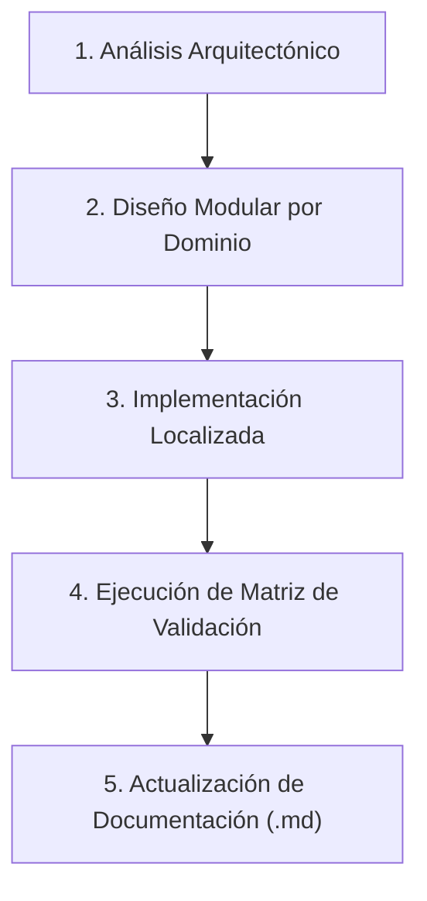

# Guía para Contribuidores de Varn

Gracias por tu interés en contribuir al desarrollo del lenguaje de programación **Varn**.

---

## Tabla de Contenidos

- [Principios de Gobernanza y Arquitectura](#principios-de-gobernanza-y-arquitectura)
- [Gobernanza de Tamaño de Archivos](#gobernanza-de-tamaño-de-archivos)
- [Principios Anti-God Object](#principios-anti-god-object)
- [Flujo de Trabajo para Nuevas Funcionalidades](#flujo-de-trabajo-para-nuevas-funcionalidades)
- [Matriz de Validación Obligatoria](#matriz-de-validación-obligatoria)
- [Reglas Estrictas del Repositorio](#reglas-estrictas-del-repositorio)

---

## Principios de Gobernanza y Arquitectura

1. **Simplicidad sobre Complejidad**: Preferir soluciones pequeñas, locales y cohesionadas. Aplicar DRY y KISS.
2. **Sin Deuda Técnica Ni Compatibilidad Legada Innecesaria**: Si un subsistema tiene defectos fundamentales, no extenderlo; reemplazarlo.
3. **Frontend / Backend Boundary**: Mantener límites estrictos entre frontend (`varn-lexer`, `varn-parser`, `varn-checker`), compilador (`varn-compiler`), backend (`varn-compiler::regalloc`), VM (`varn-vm`) y runtime nativo (`varn-builtins`, `varn-rt` para AOT).

---

## Gobernanza de Tamaño de Archivos

Para evitar la creación de *God Files*, el proyecto aplica reglas estrictas sobre la extensión de código fuente en Rust:

| Líneas de Código | Clasificación | Acción Requerida |
|---|---|---|
| `< 300` | **Ideal** | Tamaño óptimo y enfocado. |
| `300 - 400` | **Advertencia** | Monitorear responsabilidad del módulo. |
| `400 - 1000` | **Refactor Requerido (AGENTS §6)** | Partir por dominio antes de agregar nada. Puerta CI avisa; `verify.ps1`/`verify.sh`/`ci.yml` advierten >400. |
| `> 1000` | **Prohibido salvo exención legacy** | **Prohibido** añadir nuevas funciones sin dividir el archivo, salvo exenciones legacy listadas en `LEGACY_EXEMPTIONS` (`.github/workflows/ci.yml`). CI falla si un archivo no exento supera 1000 líneas. |

---

## Principios Anti-God Object

Evitar estrictamente:
- Registros monolíticos globales.
- Enums gigantescos que mezclen múltiples dominios funcionalmente dispares.
- Funciones de `dispatch` centralizadas en constante expansión.
- Módulos `utils.rs` o `helpers.rs` genéricos sin un dominio funcional bien definido.

---

## Flujo de Trabajo para Nuevas Funcionalidades



---

## Matriz de Validación y Pre-verificación Local

Ninguna tarea o Pull Request se considera completada sin pasar la matriz de 4 cuadrantes de validación:

| Procedencia Std | Modo JIT / Intérprete | Comando de Validación |
|---|---|---|
| `dev-checkout` | **JIT Activado** | `./target/release/vn run ./tests/main.vn` |
| `dev-checkout` | **Intérprete Pure (`VARN_NO_JIT=1`)** | `VARN_NO_JIT=1 ./target/release/vn run ./tests/main.vn` |
| `@embedded` | **JIT Activado** | `VARN_STD=@embedded ./target/release/vn run ./tests/main.vn` |
| `@embedded` | **Intérprete Pure (`VARN_NO_JIT=1`)** | `VARN_STD=@embedded VARN_NO_JIT=1 ./target/release/vn run ./tests/main.vn` |

`verify.ps1` añade un **cuadrante 5**: `VARN_JIT_CACHE=verify ./target/release/vn run ./tests/main.vn` recompila el código JIT cacheado en los cuadrantes 1/3 y lo compara byte a byte. `verify.sh` y CI aún no lo corren.

> [!NOTE]
> En Windows el binario es `./target/release/vn.exe`. En Linux/macOS es `./target/release/vn` (ver matriz multi-SO en `.github/workflows/ci.yml`).

> [!IMPORTANT]
> `cargo test` no ejercita la suite de integración completa del compilador. La prueba canónica del sistema es la ejecución de `tests/main.vn`.

### Scripts de Pre-verificación Automatizada

Para simplificar la validación y asegurar cero roturas antes de hacer commit/push o disparar CI/CD, disponemos de scripts de verificación:

- **Windows (PowerShell)**:
  ```powershell
  .\scripts\verify.ps1              # Ejecución completa (fmt + clippy + audit + release + 5 cuadrantes + bench)
  .\scripts\verify.ps1 -Fast        # Release sin benchmark (4 cuadrantes + cuadrante 5 de caché JIT)
  .\scripts\verify.ps1 -Quick       # Iteración: perfil `quick` (sin LTO) + solo cuadrante 1, sin lint ni bench
  .\scripts\verify.ps1 -SkipLint    # Omite cargo fmt y cargo clippy
  .\scripts\verify.ps1 -CleanCache  # Limpia la caché de Varn antes de cada cuadrante
  ```

- **Linux / macOS (Bash)**:
  ```bash
  ./scripts/verify.sh               # Ejecución completa
  ./scripts/verify.sh --fast        # Iteración rápida (sin benchmark)
  ./scripts/verify.sh --skip-lint   # Omite cargo fmt y cargo clippy
  ./scripts/verify.sh --clean-cache # Limpia la caché de Varn antes de cada cuadrante
  ```

> [!NOTE]
> Los flags son distintos por shell: `verify.ps1` usa mayúscula inicial (`-Fast`, `-Quick`, `-SkipLint`, `-CleanCache`); `verify.sh` usa minúsculas (`--fast`, `--skip-lint`, `--clean-cache`) y no tiene equivalente de `-Quick`.

`verify.ps1` ejecuta también el corpus de errores (`cargo test -p varn-cli --test error_corpus`), igual que el CI.

- **Linux limpio desde Windows (Docker)**:
  ```powershell
  .\scripts\ci-linux.ps1            # cargo clippy --workspace --all-targets + corpus de errores en rust:<toolchain>
  ```
  Reproduce lo que solo falla en Linux (código bajo `cfg`, imports sin usar, lints). Requiere Docker Desktop en ejecución.

- **Cross-check sin Docker**:
  ```powershell
  .\scripts\verify-ci-local.ps1   # cfg(unix/macos) vía `cargo check --target` + finales de línea CRLF/LF
  ```
  Red rápida (<5 min) para código de otras plataformas; no corre la suite. Requiere `rustup target add x86_64-unknown-linux-gnu aarch64-apple-darwin`.

> [!IMPORTANT]
> **Antes de `git push`**: el resumen final de `verify.ps1 -Fast` debe decir `[TODO CORRECTO]` (se lee ese resumen, no solo los totales de tests: clippy, el corpus de errores y la gobernanza de tamaño fallan sin tocar `PASSED/FAILED`). Si el cambio toca código dependiente de la plataforma, se corre además `ci-linux.ps1`. Tras el push se vigila el CI (`gh run list`, `gh run watch`) hasta verde; un CI rojo se arregla antes que cualquier trabajo nuevo.

---

## CI/CD en GitHub Actions

Un solo flujo, `.github/workflows/ci.yml`, en cada push y pull request sobre `main`, `master` y `develop`:

1. **`lint`**: `rustfmt`, `clippy` y la regla de tamaño de archivos (falla por encima de 1000 líneas salvo `LEGACY_EXEMPTIONS`).
2. **`test-matrix`**: la matriz de 4 cuadrantes en Linux, Windows y macOS.
3. **`release`** (solo en push a `main`, tras `lint` y `test-matrix`): compila el perfil `dist` para `x86_64-pc-windows-msvc`, `x86_64-unknown-linux-gnu`, `aarch64-unknown-linux-gnu`, `x86_64-apple-darwin` y `aarch64-apple-darwin`, con humo (`--version` + `run tests/main.vn`). Se salta si la etiqueta de la versión ya existe.
4. **`publish-release`**: genera `SHA256SUMS.txt` y publica los artefactos en GitHub Releases con la etiqueta `v<versión de Cargo.toml>`.

---

## Reglas Estrictas del Repositorio

> [!CAUTION]
> **Git**: commits atómicos, uno por cambio (`AGENTS.md`, Ley 9). `git add`, `commit` y `push` no requieren autorización; cualquier comando que reescriba o descarte trabajo (`reset`, `rebase`, `checkout --`, `clean -f`…) debe justificarse. Nunca `git add` de directorios enteros sin revisar lo que entra.
