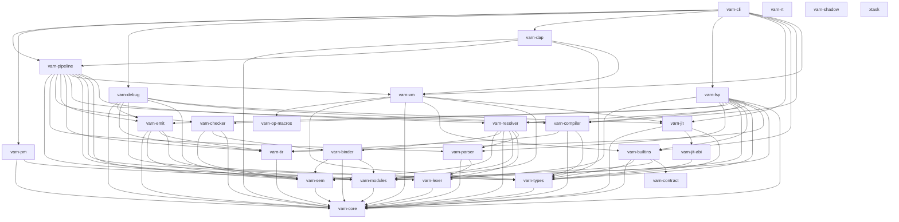

# Estado e Inventario de Crates del Workspace

Matriz de estado y jerarquía de dependencias de los **28 members** declarados en `Cargo.toml` (raíz, `members`): `varn-core`, `varn-lexer`, `varn-parser`, `varn-checker`, `varn-emit`, `varn-types`, `varn-tir`, `varn-sem`, `varn-binder`, `varn-resolver`, `varn-macros`, `varn-modules`, `varn-builtins`, `varn-cli`, `varn-lsp`, `varn-vm`, `varn-debug`, `varn-pm`, `varn-jit`, `varn-jit-abi`, `varn-pipeline`, `varn-compiler`, `varn-gpu`, `varn-text`, `varn-rt`, `varn-shadow`, `varn-dap` y `xtask`. `default-members` excluye `varn-rt`, `varn-shadow` y `xtask`.

Los conteos (líneas, tests, asserts) viven en el código y no se copian aquí: se desincronizan. La prueba canónica de integridad es `tests/main.vn` (200+ imports) bajo las cuatro combinaciones de procedencia de std y JIT descritas en [CONTRIBUTING.md](../CONTRIBUTING.md).

---

## Tabla de Contenidos

- [1. Grafo de Dependencias entre Crates](#1-grafo-de-dependencias-entre-crates)
- [2. Inventario por Dominio](#2-inventario-por-dominio)
- [3. Descripción por Dominio Funcional](#3-descripción-por-dominio-funcional)
- [4. Métricas de Gobierno de Código](#4-métricas-de-gobierno-de-código)

---

## 1. Grafo de Dependencias entre Crates

Aristas reales declaradas en los manifiestos (no el flujo de datos del pipeline):

Deuda conocida, no diseño (verificar en manifiestos antes de afirmar alcance): `varn-vm` depende directo de `varn-op-macros` (`crates/varn-vm/Cargo.toml`) y de `varn-builtins`, pero `varn-builtins` no depende de `varn-op-macros` (solo `core`/`types`/`modules`/`contract`) y `varn-op-macros` no depende de `varn-parser` (solo `proc-macro2`/`quote`/`syn`). La cadena antigua `varn-vm → varn-builtins → varn-op-macros → varn-parser` no existe en los manifiestos actuales; el frontend entra a ejecución por `varn-vm → varn-op-macros` (directa) y por `varn-resolver`/`varn-lsp`/`varn-cli`/`varn-pipeline → varn-parser`. Si `varn_contract!` parsea contratos `.vn` en tiempo de expansión, verificar en manifiestos y fuentes antes de describirlo como arista.

Las vistas de inspección que necesitan el análisis del LSP (`-p types`, `-p lsp`) viven en `varn-cli/src/inspect_lsp/`, no en el pipeline: solo requieren ruta y fuente, así que no justifican que el orquestador dependa del servidor de editor.

---

## 2. Inventario por Dominio

Sin conteos de líneas: viven en el código (`find crates -name "*.rs" | xargs wc -l`). Prueba canónica: `tests/main.vn` (200+ imports), no copiar cifras aquí.

| Crate | Dominio |
|---|---|
| `varn-core` | AST, opcodes, tokens, diagnósticos, term, `TypeTag` |
| `varn-lexer` | Frontend: tokenización |
| `varn-parser` | Frontend: parser |
| `varn-checker` | Frontend: chequeo (sobre `varn-sem` + `varn-binder`) |
| `varn-emit` | Emisión (sobre `varn-sem` + `varn-tir`) |
| `varn-sem` | Representación semántica |
| `varn-binder` | Nombres y alcances |
| `varn-resolver` | Resolución de módulos e imports |
| `varn-tir` | Representación intermedia tipada canónica |
| `varn-types` | Modelo de datos de runtime y bytecode |
| `varn-contract` | Proc-macro de contratos |
| `varn-op-macros` | Proc-macros de ops |
| `varn-compiler` | Compilador (TIR→SSA→bytecode + `regalloc` interno) |
| `varn-jit` | JIT (Cranelift, sobre `varn-jit-abi`) |
| `varn-jit-abi` | ABI del JIT |
| `varn-vm` | Ejecución |
| `varn-builtins` | Stdlib nativa |
| `varn-modules` | Resolución de módulos y bundle |
| `varn-pipeline` | Orquestación de fases y caché |
| `varn-cli` | CLI (`vn`) |
| `varn-lsp` | Servidor LSP |
| `varn-dap` | Adaptador DAP |
| `varn-debug` | Inspección de fases |
| `varn-pm` | Gestor de paquetes |
| `varn-rt` | Runtime estático para binarios AOT |
| `varn-shadow` | Binario `vn-shadow` |
| `xtask` | Herramientas (`cargo xtask`) |

---

## 3. Descripción por Dominio Funcional

### Frontend e IR Intermedio (`varn-lexer`, `varn-parser`, `varn-checker`, `varn-tir`)
Tokenización con ASI, parser descendente con precedencia Pratt, y type-checker multi-fase que emite un `TirProgram` (`varn-tir`) con tipos y resoluciones canónicas en cada nodo.

### Compilador (`varn-compiler`)
Baja `TirProgram` vía `from_tir` → SSA → bytecode, ejecuta pases de inlining de leaf functions, DCE, phis triviales, desazucarado canónico de bucles, LICM, CSE, e integra el análisis y reasignación de registros (`regalloc`).

### Ejecución (`varn-vm`, `varn-jit`)
VM de registros de 128 bits (`VmValue` con tag + payload de 64 bits, nativo `i64`/`f64` y SSO hasta 5 bytes), GC generacional (nursery + mark-sweep), optimizaciones COW para mapas vacíos e inline caches. El JIT compila eager con Cranelift (x86-64 y ARM64) y comparte la tabla de helpers con la ruta de inspección `vn debug -p clif`.

### Runtime (`varn-rt`)
`varn-rt` proporciona el runtime nativo mínimo para compilación AOT estática. No existe `varn-runtime` como crate.

---

## 4. Métricas de Gobierno de Código

Umbral real: 400 líneas por archivo, partir por dominio antes de agregar nada (AGENTS.md §6, CONTRIBUTING.md). CI avisa >400 y falla >1000 salvo exenciones legacy listadas en `LEGACY_EXEMPTIONS` (`.github/workflows/ci.yml:41`). Sin tablas de líneas por archivo aquí: se desincronizan; la auditoría se hace sobre el código.
