# Estado e Inventario de Crates del Workspace

Matriz de estado y jerarquía de dependencias de los **31 members** declarados en `Cargo.toml` (raíz, `members`): `vn-core`, `vn-lexer`, `vn-parser`, `vn-checker`, `vn-emit`, `vn-types`, `vn-tir`, `vn-sem`, `vn-binder`, `vn-resolver`, `vn-macros`, `vn-modules`, `vn-builtins`, `vn-cli`, `vn-lsp`, `vn-vm`, `vn-debug`, `vn-pm`, `vn-jit`, `vn-jit-abi`, `vn-pipeline`, `vn-compiler`, `vn-gpu`, `vn-ui`, `vn-text`, `vn-rt`, `vn-shadow`, `vn-dap`, `vn-project`, `vn-inspect` y `xtask`. `default-members` excluye `vn-rt`, `vn-shadow` y `xtask`.

Los conteos (líneas, tests, asserts) viven en el código y no se copian aquí: se desincronizan. La prueba canónica de integridad es `tests/main.vn` (200+ imports) bajo las cuatro combinaciones de procedencia de std y JIT (más el cuadrante 5 de caché JIT en `verify.ps1`) descritas en [CONTRIBUTING.md](../../CONTRIBUTING.md).

---

## Tabla de Contenidos

- [1. Grafo de Dependencias entre Crates](#1-grafo-de-dependencias-entre-crates)
- [2. Inventario por Dominio](#2-inventario-por-dominio)
- [3. Descripción por Dominio Funcional](#3-descripción-por-dominio-funcional)
- [4. Métricas de Gobierno de Código](#4-métricas-de-gobierno-de-código)

---

## 1. Grafo de Dependencias entre Crates

Aristas reales declaradas en los manifiestos (no el flujo de datos del pipeline):

```mermaid
graph TD
    vn_binder["vn-binder"] --> vn_core["vn-core"]
    vn_binder["vn-binder"] --> vn_modules["vn-modules"]
    vn_binder["vn-binder"] --> vn_sem["vn-sem"]
    vn_builtins["vn-builtins"] --> vn_core["vn-core"]
    vn_builtins["vn-builtins"] --> vn_gpu["vn-gpu"]
    vn_builtins["vn-builtins"] --> vn_macros["vn-macros"]
    vn_builtins["vn-builtins"] --> vn_modules["vn-modules"]
    vn_builtins["vn-builtins"] --> vn_text["vn-text"]
    vn_builtins["vn-builtins"] --> vn_types["vn-types"]
    vn_builtins["vn-builtins"] --> vn_ui["vn-ui"]
    vn_checker["vn-checker"] --> vn_binder["vn-binder"]
    vn_checker["vn-checker"] --> vn_core["vn-core"]
    vn_checker["vn-checker"] --> vn_sem["vn-sem"]
    vn_cli["vn-cli"] --> vn_builtins["vn-builtins"]
    vn_cli["vn-cli"] --> vn_checker["vn-checker"]
    vn_cli["vn-cli"] --> vn_compiler["vn-compiler"]
    vn_cli["vn-cli"] --> vn_core["vn-core"]
    vn_cli["vn-cli"] --> vn_dap["vn-dap"]
    vn_cli["vn-cli"] --> vn_debug["vn-debug"]
    vn_cli["vn-cli"] --> vn_jit["vn-jit"]
    vn_cli["vn-cli"] --> vn_lexer["vn-lexer"]
    vn_cli["vn-cli"] --> vn_lsp["vn-lsp"]
    vn_cli["vn-cli"] --> vn_modules["vn-modules"]
    vn_cli["vn-cli"] --> vn_parser["vn-parser"]
    vn_cli["vn-cli"] --> vn_pipeline["vn-pipeline"]
    vn_cli["vn-cli"] --> vn_pm["vn-pm"]
    vn_cli["vn-cli"] --> vn_resolver["vn-resolver"]
    vn_cli["vn-cli"] --> vn_sem["vn-sem"]
    vn_cli["vn-cli"] --> vn_types["vn-types"]
    vn_cli["vn-cli"] --> vn_vm["vn-vm"]
    vn_compiler["vn-compiler"] --> vn_core["vn-core"]
    vn_compiler["vn-compiler"] --> vn_tir["vn-tir"]
    vn_compiler["vn-compiler"] --> vn_types["vn-types"]
    vn_core["vn-core"]
    vn_dap["vn-dap"] --> vn_core["vn-core"]
    vn_dap["vn-dap"] --> vn_pipeline["vn-pipeline"]
    vn_dap["vn-dap"] --> vn_types["vn-types"]
    vn_dap["vn-dap"] --> vn_vm["vn-vm"]
    vn_debug["vn-debug"] --> vn_compiler["vn-compiler"]
    vn_debug["vn-debug"] --> vn_core["vn-core"]
    vn_debug["vn-debug"] --> vn_emit["vn-emit"]
    vn_debug["vn-debug"] --> vn_jit["vn-jit"]
    vn_debug["vn-debug"] --> vn_sem["vn-sem"]
    vn_debug["vn-debug"] --> vn_tir["vn-tir"]
    vn_debug["vn-debug"] --> vn_types["vn-types"]
    vn_emit["vn-emit"] --> vn_core["vn-core"]
    vn_emit["vn-emit"] --> vn_modules["vn-modules"]
    vn_emit["vn-emit"] --> vn_sem["vn-sem"]
    vn_emit["vn-emit"] --> vn_tir["vn-tir"]
    vn_gpu["vn-gpu"]
    vn_jit_abi["vn-jit-abi"] --> vn_types["vn-types"]
    vn_jit["vn-jit"] --> vn_core["vn-core"]
    vn_jit["vn-jit"] --> vn_jit_abi["vn-jit-abi"]
    vn_jit["vn-jit"] --> vn_types["vn-types"]
    vn_lexer["vn-lexer"] --> vn_core["vn-core"]
    vn_lsp["vn-lsp"] --> vn_builtins["vn-builtins"]
    vn_lsp["vn-lsp"] --> vn_checker["vn-checker"]
    vn_lsp["vn-lsp"] --> vn_compiler["vn-compiler"]
    vn_lsp["vn-lsp"] --> vn_core["vn-core"]
    vn_lsp["vn-lsp"] --> vn_emit["vn-emit"]
    vn_lsp["vn-lsp"] --> vn_lexer["vn-lexer"]
    vn_lsp["vn-lsp"] --> vn_modules["vn-modules"]
    vn_lsp["vn-lsp"] --> vn_parser["vn-parser"]
    vn_lsp["vn-lsp"] --> vn_resolver["vn-resolver"]
    vn_lsp["vn-lsp"] --> vn_sem["vn-sem"]
    vn_lsp["vn-lsp"] --> vn_tir["vn-tir"]
    vn_lsp["vn-lsp"] --> vn_types["vn-types"]
    vn_macros["vn-macros"] --> vn_core["vn-core"]
    vn_macros["vn-macros"] --> vn_lexer["vn-lexer"]
    vn_macros["vn-macros"] --> vn_parser["vn-parser"]
    vn_modules["vn-modules"] --> vn_core["vn-core"]
    vn_parser["vn-parser"] --> vn_core["vn-core"]
    vn_pipeline["vn-pipeline"] --> vn_checker["vn-checker"]
    vn_pipeline["vn-pipeline"] --> vn_compiler["vn-compiler"]
    vn_pipeline["vn-pipeline"] --> vn_core["vn-core"]
    vn_pipeline["vn-pipeline"] --> vn_emit["vn-emit"]
    vn_pipeline["vn-pipeline"] --> vn_lexer["vn-lexer"]
    vn_pipeline["vn-pipeline"] --> vn_modules["vn-modules"]
    vn_pipeline["vn-pipeline"] --> vn_parser["vn-parser"]
    vn_pipeline["vn-pipeline"] --> vn_resolver["vn-resolver"]
    vn_pipeline["vn-pipeline"] --> vn_sem["vn-sem"]
    vn_pipeline["vn-pipeline"] --> vn_tir["vn-tir"]
    vn_pipeline["vn-pipeline"] --> vn_types["vn-types"]
    vn_pipeline["vn-pipeline"] --> vn_vm["vn-vm"]
    vn_pm["vn-pm"] --> vn_core["vn-core"]
    vn_pm["vn-pm"] --> vn_modules["vn-modules"]
    vn_resolver["vn-resolver"] --> vn_binder["vn-binder"]
    vn_resolver["vn-resolver"] --> vn_core["vn-core"]
    vn_resolver["vn-resolver"] --> vn_lexer["vn-lexer"]
    vn_resolver["vn-resolver"] --> vn_modules["vn-modules"]
    vn_resolver["vn-resolver"] --> vn_parser["vn-parser"]
    vn_resolver["vn-resolver"] --> vn_sem["vn-sem"]
    vn_rt["vn-rt"]
    vn_sem["vn-sem"] --> vn_core["vn-core"]
    vn_shadow["vn-shadow"]
    vn_text["vn-text"]
    vn_tir["vn-tir"] --> vn_core["vn-core"]
    vn_types["vn-types"] --> vn_core["vn-core"]
    vn_ui["vn-ui"]
    vn_vm["vn-vm"] --> vn_builtins["vn-builtins"]
    vn_vm["vn-vm"] --> vn_core["vn-core"]
    vn_vm["vn-vm"] --> vn_jit["vn-jit"]
    vn_vm["vn-vm"] --> vn_macros["vn-macros"]
    vn_vm["vn-vm"] --> vn_modules["vn-modules"]
    vn_vm["vn-vm"] --> vn_types["vn-types"]
    vn_project["vn-project"]
    vn_modules["vn-modules"] --> vn_project["vn-project"]
    vn_pm["vn-pm"] --> vn_project["vn-project"]
    vn_pipeline["vn-pipeline"] --> vn_project["vn-project"]
    vn_cli["vn-cli"] --> vn_project["vn-project"]
    vn_cli["vn-cli"] --> vn_inspect["vn-inspect"]
    vn_inspect["vn-inspect"] --> vn_lsp["vn-lsp"]
    vn_inspect["vn-inspect"] --> vn_debug["vn-debug"]
    vn_lsp["vn-lsp"] --> vn_pipeline["vn-pipeline"]
    xtask["xtask"]
```

Solo `[dependencies]` (sin dev/build). `vn-macros` parsea los contratos `.vn` en tiempo de expansión, por eso depende de `vn-lexer`/`vn-parser`; `vn-builtins` usa los mismos dos solo como build-dependencies (su `build.rs` genera `MODULE_REGISTRY`). La ejecución alcanza el frontend por `vn-vm → vn-macros` y `vn-vm → vn-builtins → vn-macros`.

Las vistas de inspección que necesitan el análisis del LSP (`-p types`, `-p lsp`) viven en el crate `vn-inspect` (depende de `vn-lsp` y `vn-debug`), no en el pipeline: solo requieren ruta y fuente, así que no justifican que el orquestador dependa del servidor de editor.

---

## 2. Inventario por Dominio

Sin conteos de líneas: viven en el código (`find crates -name "*.rs" | xargs wc -l`). Prueba canónica: `tests/main.vn` (200+ imports), no copiar cifras aquí.

| Crate | Dominio |
|---|---|
| `vn-core` | AST, opcodes, tokens, diagnósticos, ids de módulo y de op, huellas, `RuntimeKind` |
| `vn-lexer` | Frontend: tokenización |
| `vn-parser` | Frontend: parser |
| `vn-checker` | Frontend: chequeo (sobre `vn-sem` + `vn-binder`) |
| `vn-emit` | Emisión (sobre `vn-sem` + `vn-tir`) |
| `vn-sem` | Representación semántica |
| `vn-binder` | Nombres y alcances |
| `vn-resolver` | Resolución de módulos e imports |
| `vn-tir` | Representación intermedia tipada canónica |
| `vn-types` | Modelo de datos de runtime y bytecode |
| `vn-macros` | Proc-macros: `varn_contract!`, `#[jit_slow]`, `jit_helper_table!` |
| `vn-compiler` | Compilador (TIR→SSA→bytecode + `regalloc` interno) |
| `vn-jit` | JIT (Cranelift, sobre `vn-jit-abi`) |
| `vn-jit-abi` | ABI del JIT |
| `vn-vm` | Ejecución |
| `vn-builtins` | Stdlib nativa |
| `vn-modules` | Resolución de módulos y bundle |
| `vn-pipeline` | Orquestación de fases y caché |
| `vn-cli` | CLI (`vn`) |
| `vn-lsp` | Servidor LSP |
| `vn-dap` | Adaptador DAP |
| `vn-debug` | Inspección de fases |
| `vn-pm` | Gestor de paquetes |
| `vn-gpu` | Cómputo GPU (host) |
| `vn-ui` | UI nativa (host) |
| `vn-text` | Shaping de texto (host) |
| `vn-rt` | Runtime estático para binarios AOT |
| `vn-shadow` | Binario `vn-shadow` |
| `xtask` | Herramientas (`cargo xtask`) |

---

## 3. Descripción por Dominio Funcional

### Frontend e IR Intermedio (`vn-lexer`, `vn-parser`, `vn-checker`, `vn-tir`)
Tokenización (punto y coma opcional), parser descendente con precedencia por niveles, y type-checker que produce un `CheckResult`; `vn-emit` lo baja a un `TirModule` (`vn-tir`) con tipos y resoluciones canónicas en cada nodo.

### Compilador (`vn-compiler`)
Baja `TirModule` vía `from_tir` → SSA → bytecode, con pases a punto fijo (const-fold, guardas redundantes, monomorfización, álgebra, CSE, campos fijos, escape, LICM, DCE, simplificación de CFG), transformación a máquina de estados para async/generadores y regalloc. Ver `COMPILER_ARCHITECTURE.md`.

### Ejecución (`vn-vm`, `vn-jit`)
VM de registros de 128 bits (`VmValue` con tag + payload de 64 bits, nativo `i64`/`f64` y SSO hasta 8 bytes), GC generacional no copiante (generación joven `born` + marcas pegajosas en old-gen) e inline caches. El JIT (Cranelift, x86-64 y ARM64) entra por tiering: umbral 1 llamada si la función tiene bucle, 128 si no, y OSR a los 1000 back-edges; comparte la tabla de helpers con `vn debug -p clif`.

### Runtime (`vn-rt`)
`vn-rt` proporciona el runtime nativo mínimo para compilación AOT estática. No existe `varn-runtime` como crate.

---

## 4. Métricas de Gobierno de Código

Umbral real: 400 líneas por archivo, partir por dominio antes de agregar nada (AGENTS.md §6, CONTRIBUTING.md). CI avisa >400 y falla >1000 salvo exenciones legacy listadas en `LEGACY_EXEMPTIONS` (`.github/workflows/ci.yml:41`). Sin tablas de líneas por archivo aquí: se desincronizan; la auditoría se hace sobre el código.
